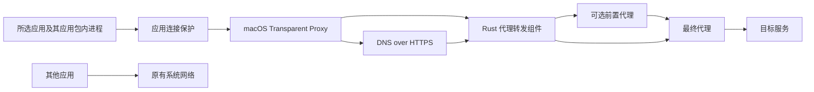

该组件提供 HTTP 转发、CONNECT 隧道和可选前置代理，通过 Rust FFI 供 macOS Network Extension 调用。

配置中的 `upstream` 指定最终代理，`frontProxy` 指定可选前置代理。省略 `frontProxy` 或填写空字符串时，程序按照本机现有网络路径连接最终代理。填写前置代理后，连接依次经过前置代理与最终代理；任意一段失败都会返回错误。

两段代理均接受固定 IP 的 HTTP、HTTPS、SOCKS5h 地址及可选的用户名、密码。目标域名交给最终代理处理。HTTPS 代理的证书需要对填写的 IP 有效。转发组件保留目标 HTTPS 的 TLS 内容。

程序在 loopback 动态端口接受 HTTP 请求和 CONNECT 隧道。所有上游连接均使用同一条代理链。组件停止时关闭连接。组件的通过结果只覆盖进入组件的请求；应用进程接管、系统 DNS 与更新后的持续保护需要单独验证。

真实网络检查位于 `tools/macos-network-probe/validate_gateway_chain.py`。2026-10-02 的 18 项检查通过，结果保存在忽略目录 `work/gateway-chain-verification/results.json`：

| 配置 | HTTPS 请求 | HTTP 请求 | 停止组件后的请求 |
| --- | --- | --- | --- |
| 省略前置代理 | 成功 | 成功 | 失败 |
| 前置代理为空字符串 | 成功 | 成功 | 失败 |
| SOCKS5h 前置代理 | 成功，出口 IP 符合配置 | 成功 | 失败 |
| HTTP 前置代理 | 成功，出口 IP 符合配置 | 成功 | 失败 |
| 前置代理不可用 | 失败 | 失败 | 失败 |
| 最终代理不可用 | 失败 | 失败 | 失败 |

测试使用本机正在运行的代理及实际外部节点，没有使用 mock。配置文件含有凭据，需要保存在忽略目录并设置文件权限 `0600`。测试程序通过标准输入传入配置，结果文件不包含代理认证信息。

在 ARM64 Mac 上执行：

```sh
env RUSTUP_TOOLCHAIN=1.95-aarch64-apple-darwin cargo build --manifest-path crates/app-egress/Cargo.toml --target aarch64-apple-darwin --release --offline --example gateway
python3 tools/macos-network-probe/validate_gateway_chain.py --binary crates/app-egress/target/aarch64-apple-darwin/release/examples/gateway --configuration work/chain-native.json --output work/gateway-chain-verification
```

macOS 应用保护位于 `tools/macos-network-probe/`，使用 `NETransparentProxyProvider` 与 `NEFilterDataProvider`。控制界面位于 CC Switch 的「设置 → 路由 → ChatGPT / Codex 应用连接保护」。



应用匹配使用 macOS 提供的来源 audit token 与应用包路径。应用包内部的辅助进程也使用该路径规则；应用更新后，新进程继续匹配同一路径。应用包之外单独启动的终端工具与 MCP 服务不在此匹配范围。

系统替应用发起的 UDP DNS 查询使用来源应用标识，经过相同代理链发送到 `https://1.1.1.1/dns-query`。普通 UDP 连接被拒绝。代理停止时，独立的 Filter 继续拒绝所选应用的新连接。首次启用需要重新启动所选应用，以结束启用前已经建立的连接。

2026-10-02 的本机验证包括：

- 23 项透明代理检查通过，覆盖 HTTP、HTTPS、WebSocket、系统 DNS、显式代理、IPv4、IPv6、前置代理故障、最终代理故障及停止后的连接限制。
- 9 项应用路径检查通过，覆盖应用名单刷新、应用二进制更新、本机 API、代理停止、扩展异常退出和重新启动。
- 4 项同时联网检查通过，确认所选验证应用受限时，未选择的程序仍能完成公网请求。
- 修改版本地安装后，签名校验、二进制一致性及 `127.0.0.1:15721/health` 检查通过。

上述结果来自本机验证程序。正式 ChatGPT/Codex 应用接管尚未启用；不能将这些结果解释为所有应用、所有网络环境均无泄露。

该个人分发包要求 macOS 26。免费 ad-hoc 签名的 Network Extension 已在本机 SIP 关闭的条件下运行，SIP 开启的机器尚未验证可用。普通 UDP 被阻断，依赖 UDP 的语音功能可能受到影响。

构建应用：

```sh
bash tools/macos-network-probe/build.sh
pnpm tauri build --bundles app --config src-tauri/tauri.app-egress.conf.json
```

在应用中安装网络扩展，完成 macOS 授权，保存最终代理地址，按需填写前置代理，选择已经安装的应用并启用保护。前置代理留空时保留本机现有网络路径；填写前置代理时使用指定的代理链。运行期间不修改其他 VPN、Clash 的规则或系统代理设置。
